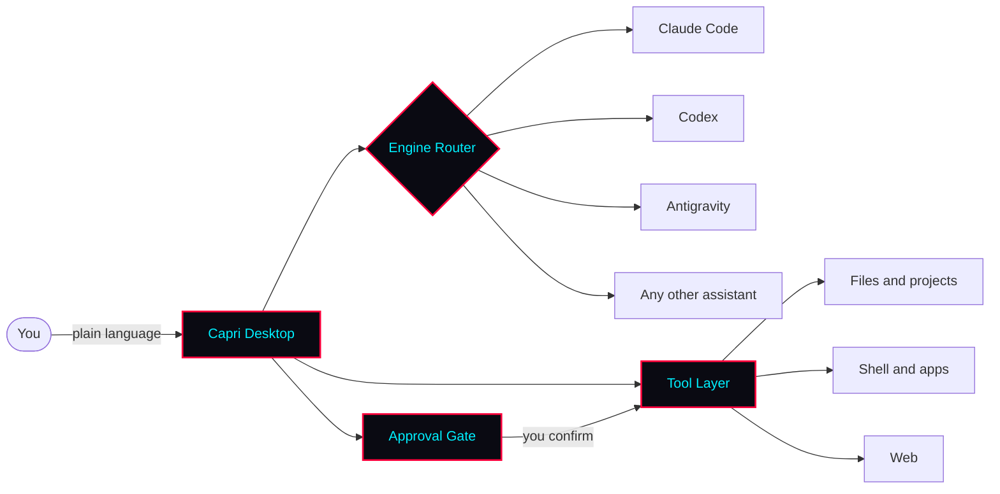

> 本页保存的是公开项目资料快照，阅读过程不需要连接 GitHub。

# Capri AI — Cyberpunk Desktop Pet, Gaming Overlay & Voice Companion for Windows

**Capri AI Desktop** turns your Windows 10/11 screen into an interactive cyberpunk workspace. Instead of staring at a dark terminal, you get a visual desktop pet and AI operator that perches on your windows, talks in 80 languages, joins Discord voice calls, and automates tasks through **Claude Code**, **Codex**, **Ollama**, **DeepSeek**, and **MCP servers**.


  
  
  
  

  *图片：Release*
  *图片：Stars*
  *图片：Platform*


  
    
  
  


**Features** · **Quick Start** · **What You Can Ask** · **How It Works** · **Roadmap** · **FAQ**


##  Quick Start

### 1. Download

Capri is currently available for **Windows** as a portable build:

| Format | Download | Best for |
|---|---|---|
|  **Portable** | `Capri-Portable.zip` | Running Capri from any folder, no installation needed |

Requires Windows 10 or newer. macOS and Linux versions are on the roadmap.

### 2. Install and launch

- **Portable:** put the portable build in any folder and run it. No installation needed.

### 3. Connect your AI

On first launch, Capri asks which assistant to use. Sign in to your account or paste your API key for **Claude Code**, **Codex**, **Antigravity** or another supported assistant.

---

## Design & Aesthetic

Capri takes visual cues from *Cyberpunk: Edgerunners* and classic netrunner interfaces. Instead of a standard utility window, you get a compact HUD character that lives directly on your desktop.

- **Visual style:** High-contrast crimson and cyan accents over matte black, angular frames, and subtle glitch transitions.
- **Direct execution:** You state the task in plain text or voice, and the agent handles the clicks, files, and commands.
- **Local control:** Built to stay out of the way until called, with an immediate kill-switch (`Esc`) whenever she is automating your cursor.

---

## Core Capabilities

- **Voice and text chat:** Talk to her directly or enable the `"Hey Capri"` wake word. She replies naturally across 80 languages.
- **Custom voice synthesis:** Use her built-in offline voice, load your own local voice model, or connect Fish Audio, ElevenLabs, or OpenAI. See Her voice.
- **Gaming overlay:** She watches your screen while you play, reacts to events in real time, and has experimental support for basic game inputs.
- **Desktop automation:** She launches programs, controls media, closes browser tabs, and navigates UI workflows using her own cursor. Interrupt her mid-action anytime by speaking or pressing `Esc`.
- **Local memory:** Conversation logs and screen context stay stored locally on your drive.
- **Window perching:** She sits on top of active windows, reacts to system audio rhythms, or docks neatly along the edge of your screen.
- **Mini media player:** Includes a compact Windows playback widget with Capri perched right on top.


  
    Her mini player
    Talking to her
    The Mainframe
  


Voice Call Integration

Real footage, sped up in places. Other people's names and avatars and the server are cropped out or blurred.

Tell her to hop into your Discord channel and relay a message—for example: *"Hey Capri, join the call, tell them I'll be back in 15 minutes, and boot up whatever they're playing."*

- **Autonomous channel joining:** She locates and clicks the Join Voice button herself, then updates your party with a custom excuse while you are AFK.
- **Game and media launching:** If friends in the call request a specific Steam game or track, she can launch it on your machine.
- **Multi-app support:** Beyond Discord, call mode works with Zoom, Microsoft Teams, WhatsApp, Telegram, Slack, Signal, Skype, TeamSpeak, Mumble, Steam Voice, and browser-based calls. Select a target under `VOICE > Call app` or leave it on Auto.
- **Live call UI:** Displays active voice rings for each speaker, real-time speech captions, a quick hang-up button, and a compact floating pill when minimized.
- **Speaker separation:** Distinguishes your voice from incoming call audio—only your voice triggers the wake word or approves actions, preventing Discord audio bleed from hijacking commands.
- **Friend command gating:** By default, requests coming from other people in the call require your explicit confirmation via mic or keyboard (`SECURITY` toggle).
- **Natural interruption handling:** Continues speaking through brief laughs or backchannels, but pauses immediately if someone speaks over her for more than a second.
- **Virtual mic routing:** Route her voice into your call via `Settings > VOICE > Her voice in your mic` using `CABLE Output` or `Steam Streaming Microphone`. Audio routing stays active only during calls and includes a dedicated gain slider.

Call mode is currently a Windows-only beta feature. Ask her to join a call to activate it, or toggle **Call mode (beta)** in the chat input bar. If she stops after a single sentence on Discord, disable Discord's built-in **Echo Cancellation** and **Noise Suppression**.


Modding & Customization

Open **Mods** from the CAPRI bar inside the Mainframe to browse the mods directory. You can preview, download, install with one click, import local packages, or submit your own.

**Nine starter mods included (by Vocyn):** four color schemes (Bubblegum, Cyber Cyan, Royal, and Toxic), Custom Names, Sharper Ears, Hearing Log, Hello Code, and Startup Intros.


  
  Startup Intros. Say "intro shatter" to lock one in, or "intro shuffle" to mix them up.


- **Config mods (`.capri-mod`) and skins (`.capri-skin`):** Config mods adjust behavior parameters, while skins alter her appearance. Skins support layering—enable multiple outfits or accessories (like cat ears) at the same time.
- **Scripted code mods (`.capri-code`):** Execute custom logic on your machine. Capri prompts you for permission before running a code mod for the first time or after any file modification, listing all requested hooks (chat, voice, memory, hotkeys, idle triggers). Check mods/MODDING.md for documentation.
- Every submission in the official directory undergoes malware screening before listing.
- **Built-in color editor:** Adjust Hair, Accents, Eyes, Edges, or Body colors directly on the Mods tab and export the result as a shareable `My Colors` package.
- **Publishing:** Fork capri-mods, add a directory containing your mod file, a `README`, and a `preview.png`, then submit a pull request.


---

## Example Prompts

| Command | Execution |
|---|---|
| *"Join the Discord call, tell them I'm grabbing coffee, and launch Cyberpunk 2077."* | Clicks into the voice channel, relays the message to your party, and boots the game via Steam. |
| *"Close Chrome and heavy background apps so I can play."* | Identifies memory-heavy processes, asks for confirmation, and clears system resources. |
| *"Clip the last minute of gameplay or check what's killing my FPS."* | Triggers your capture hotkey or inspects active background processes hogging GPU/CPU. |
| *"Sort my Downloads folder into subfolders by file extension."* | Scans the directory, outlines the file structure, and moves files once you confirm. |
| *"Locate the bug in this repository and patch it."* | Inspects project files, isolates the error, applies a fix, and runs verification checks. |
| *"Merge all PDFs in this directory into a single summary."* | Parses each document and compiles a unified overview file. |
| *"Back up my Documents folder every Monday morning."* | Registers a scheduled recurring workflow for the directory. |


---

##  How It Works



1. **You describe the goal** in plain language.
2. **Capri routes it** to the AI engine you selected.
3. **The engine plans the steps** and asks Capri to use tools.
4. **You approve sensitive actions**, and Capri carries them out on your desktop.


### Supported engines

| Engine | Status |
|---|:---:|
| Claude Code | ✅ Supported |
| Codex | ✅ Supported |
| Antigravity | ✅ Supported |
| Other assistants | 🧩 Via custom adapter |


---

##  Configuration


```yaml
# Example config
engine: claude-code        # claude-code | codex | antigravity | custom

permissions:
  mode: ask                # ask before acting | auto | read-only
  allowed_folders:
    - ~/Documents
    - ~/Projects

interface:
  theme: cyberpunk
```

---

##  Safety

An agent that works on your desktop is powerful, so treat it with care:

- **Review before you approve.** Read what Capri is about to do, especially for deleting, moving or overwriting files.
- **Limit the scope.** Give Capri access only to the folders it needs.
- **Keep backups.** Back up important data before running large automated tasks.
- **Protect your keys.** Never share your API keys or account tokens with anyone.


---

##  Roadmap


- [x] Windows app ( portable)
- [x] Multiple AI engines
- [x] Voice control
- [ ] macOS version
- [ ] Linux version
- [ ] Plugin system
- [ ] Task scheduler
- [ ] Mobile companion
- [ ] Community cyberpunk theme gallery

Have an idea? Open an issue and tell us what Capri should learn next.

---

## ❓ FAQ


Does Capri work on macOS or Linux?


Not yet. Capri is currently available for Windows as a portable build (`.zip`). macOS and Linux versions are planned, so star the repository to follow the progress.


Do I need to know how to code?


No. Download the app, connect your AI and describe what you need in plain language.


Which AI assistants does Capri support?


Claude Code, Codex and Antigravity out of the box, plus other assistants through custom adapters.


Is it safe to let an AI control my desktop?


Capri is designed so you can review actions before they run, but no tool is risk-free. Limit folder access, keep backups and read the Safety section.


Where does my data go?


Your requests are processed by the AI assistant you connect, under that provider's terms and privacy policy. 


Is Capri an official Cyberpunk or Edgerunners product?


No. Capri is an independent, unofficial fan project with a cyberpunk aesthetic, inspired by *Cyberpunk: Edgerunners*. It is not affiliated with or endorsed by CD PROJEKT RED, Studio Trigger, Netflix or any other rights holder.


---

## Quick Troubleshooting

If you encounter any issues while running Capri AI, check these quick fixes before opening an issue:

### 1. Local Ollama / LLaMA Models Disconnecting
* **Why it happens:** Host connection timeout or missing CORS headers in your local setup.
* **Fix:** Make sure Ollama is running in the background before launching Capri. If you are using a custom port, update the `allowed_folders` and server URL inside your `config.yaml`.

### 2. Voice Chat or Audio Input Lag
* **Why it happens:** Discord, Teams, or Zoom background noise suppression conflicting with Qwen3-ASR.
* **Fix:** Go to your voice app settings (e.g., Discord Audio Settings) and temporarily disable **Echo Cancellation** and **Krisp/Noise Suppression**. Let Capri handle the voice gating.

--- 

## Supported Workflows & Alternatives

Capri Desktop acts as a free, open-source, local-first alternative and wrapper for:
- **Anthropic Claude Code** (Provides a beautiful desktop Cyberpunk GUI instead of a dark terminal)
- **DeepSeek-V3 / DeepSeek-R1 Native Client** (Run ultra-cheap API routing on your Windows desktop)
- **Open-Interpreter & Desktop-Agent alternatives** (Full mouse and keyboard automation layer)
- **Ollama / LLaMA.cpp Desktop Companion** (100% local offline AI Waifu execution)

---

## Documentation & Guides

- **Local AI & Ollama Setup** — Run DeepSeek-R1, Qwen, and Llama models 100% offline.
- **Discord Call Mode Guide** — Virtual microphone routing and voice chat setup for Windows.
- **Roadmap & Platform Ports** — Track progress for macOS, Linux, and custom `.capri-skin` modding.

---


**If Capri saves you time, drop a ⭐ and share it with a friend.**

*Stay sharp, edgerunner.*
