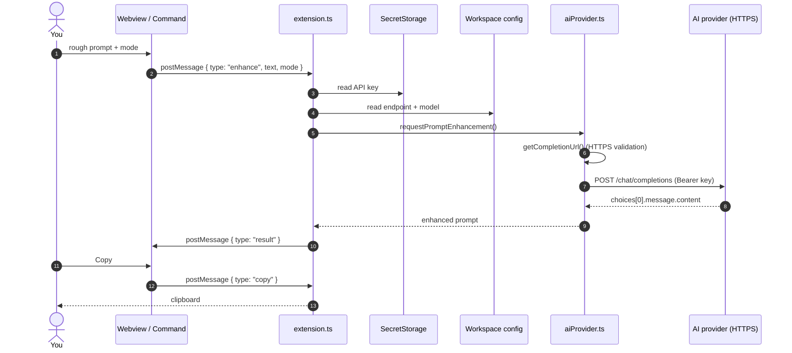

> 本页保存的是公开项目资料快照，阅读过程不需要连接 GitHub。

*图片：Universal AI Prompt Engineer*

# Universal AI Prompt Engineer

**Turn rough prompts into professional, review-ready instructions for AI coding agents — without leaving VS Code.**

*图片：Version*
*图片：License*
[*图片：VS Code*](https://code.visualstudio.com/)
*图片：Tests*
*图片：PRs welcome*

---

## Table of contents

- Why this extension
- Features
- Screenshots
- Quick start
- The nine modes
- Ways to run an enhancement
- Commands
- Keyboard shortcuts
- Settings
- Output modes
- How it works
- Privacy and security
- Requirements
- Install from source
- Testing
- Packaging and publishing
- Project structure
- Troubleshooting
- Roadmap
- Contributing
- License

---

## Why this extension

Short prompts produce vague work. "Fix the save button" gives an agent no scope, no evidence
requirements and no definition of done, so you get a plausible-looking change that misses the
actual bug.

Prompt engineering fixes this, but rewriting every request by hand is slow and inconsistent.
This extension gives you a **panel inside VS Code** that takes the rough version and returns a
structured instruction — with the right emphasis for the task at hand (implementation, debugging,
review, design, gameplay, autonomy) — in a single keystroke.

- **No prompt library to memorise.** Nine modes encode the structure for you.
- **Bring your own model.** Any OpenAI-compatible `/chat/completions` endpoint works.
- **No secrets in your settings.** The API key lives in VS Code `SecretStorage`.
- **Works where you already work.** Selection, clipboard, panel, sidebar, status bar, palette.

---

## Features

| | |
|---|---|
| **Nine enhancement modes** | Quick, Professional, Developer, Architect, Debugging, Code Review, UI/UX, Game Development, Autonomous Agent |
| **Dedicated panel** | Two-column editor/result layout that follows your VS Code theme (dark, light, high contrast) |
| **Selection aware** | `Ctrl+Alt+P` enhances the selected text; the sidebar pre-fills it into the panel |
| **Clipboard aware** | Enhance whatever you copied from any chat or document |
| **Configurable output** | Show in panel, copy to clipboard, or replace the selection in place |
| **Secret-safe** | API key stored in `SecretStorage`, never in `settings.json`, never echoed back to the UI |
| **Honest errors** | Provider failures are surfaced verbatim (HTTP status + provider message), never replaced with a fake success |
| **Guard rails** | HTTPS-only endpoints, no credentials in URLs, 20,000 character cap, 90 second timeout |
| **Zero runtime dependencies** | Only `vscode` and Node's built-in `fetch` |

---

## Screenshots

### The sidebar and the enhanced result

*图片：Prompt Engineer sidebar inside VS Code*

### The Prompt Engineer panel

| Dark theme | Light theme |
|---|---|
| *图片：Panel, dark theme* | *图片：Panel, light theme* |

---

## Quick start

> **You need your own API key.** The extension does not bundle a key, host a model, or pay for
> provider usage. Any OpenAI-compatible provider works.

### 1. Install

- **VS Code Marketplace:** `Ctrl+Shift+X` → search **Universal AI Prompt Engineer** → **Install**
- **From a VSIX file:** `code --install-extension universal-ai-prompt-engineer-0.2.0.vsix`

### 2. Connect your provider (once)

1. Press `Ctrl+Alt+O` or click **$(sparkle) Prompt Engineer** in the status bar.
2. Expand **Provider settings** and fill in:

   | Field | Example |
   |---|---|
   | HTTPS API endpoint | `https://api.openai.com/v1` |
   | Model | `gpt-4o-mini` |
   | API key | *your key* |

3. Click **Save provider settings**. The header pill changes to **Provider connected**.

The key is written to VS Code `SecretStorage`. Leaving the key field blank on later saves keeps
the stored key unchanged.

### 3. Enhance

1. Type or paste your rough prompt.
2. Pick a mode.
3. Press **Enhance prompt** (or `Ctrl+Enter`).
4. Press **Copy** and paste the result into Copilot Chat, Claude, Cursor, or any agent.

*图片：How it flows*

---

## The nine modes

| Mode | What it optimises for | Good for |
|---|---|---|
| **Quick Enhance** | Tight, specific wording — no extra structure | one-line asks, follow-up messages |
| **Professional Enhance** | Context, scope, deliverables, success criteria | general work, documentation, mixed tasks |
| **Developer Mode** | Conventions, error handling, security, focused tests | implementing a feature in an existing codebase |
| **Expert Architect** | Requirements, boundaries, data flow, trade-offs, staged delivery | system design, migrations, cross-cutting change |
| **Debugging Mode** | Reproduction, evidence, root cause, minimal fix, regression check | "it sometimes breaks" reports |
| **Code Review Mode** | Prioritised findings by severity — no unsolicited rewrites | reviewing a PR or a diff |
| **UI/UX Mode** | User goals, layout, responsive behaviour, accessibility, states | screens, flows, design-system work |
| **Game Development Mode** | Mechanics, controls, feedback, assets, performance, playtesting | gameplay and engine work |
| **Autonomous Agent Mode** | Inspect → plan → implement → verify → report actual results | long-running agent tasks |

Every mode preserves your intent. The system prompt explicitly forbids inventing technologies,
requirements or results, and tells the downstream assistant to inspect the project when context
is unknown.

---

## Ways to run an enhancement

| Entry point | How | Source text |
|---|---|---|
| **Panel** | `Ctrl+Alt+O` → paste → **Enhance** | what you typed |
| **Selection** | select text → right-click → **Enhance Selected Prompt** or `Ctrl+Alt+P` | the selection |
| **Clipboard** | `Ctrl+Shift+P` → **Enhance Prompt from Clipboard** | the clipboard |
| **Sidebar** | Activity Bar → **Prompt Engineer** → click a mode | current selection (pre-filled) |
| **Palette** | `Ctrl+Shift+P` → **AI Prompt Engineer: …** | input box |
| **Status bar** | click **$(sparkle) Prompt Engineer** | opens the panel |

---

## Commands

| Command | Default binding |
|---|---|
| `AI Prompt Engineer: Enhance Selected Prompt` | `Ctrl+Alt+P` (with selection) |
| `AI Prompt Engineer: Enhance Prompt from Clipboard` | — |
| `AI Prompt Engineer: Open Prompt Engineer Panel` | `Ctrl+Alt+O` |
| `AI Prompt Engineer: Set API Key` | — |
| `AI Prompt Engineer: Clear API Key` | — |
| `AI Prompt Engineer: Quick Enhance` | — |
| `AI Prompt Engineer: Professional Enhance` | — |
| `AI Prompt Engineer: Developer Mode` | — |
| `AI Prompt Engineer: Expert Architect Mode` | — |
| `AI Prompt Engineer: Debugging Mode` | — |
| `AI Prompt Engineer: Code Review Mode` | — |
| `AI Prompt Engineer: UI/UX Mode` | — |
| `AI Prompt Engineer: Game Development Mode` | — |
| `AI Prompt Engineer: Autonomous Agent Mode` | — |

Internal commands used by the sidebar and webview: `openPromptPanelWithMode`,
`enhanceSelectionWithMode`, `enhanceClipboardWithMode`.

---

## Keyboard shortcuts

| Shortcut | Action |
|---|---|
| `Ctrl+Alt+O` | open / reveal the panel |
| `Ctrl+Alt+P` | enhance the current selection |
| `Ctrl+Enter` (in panel) | run the enhancement |

All bindings can be changed in **Keyboard Shortcuts** (`Ctrl+K Ctrl+S`) by searching for
`universalAIPromptEngineer`.

---

## Settings

| Setting | Default | Description |
|---|---|---|
| `universalAIPromptEngineer.apiEndpoint` | `https://api.openai.com/v1` | HTTPS base URL of an OpenAI-compatible API. Must use HTTPS, no credentials, query or fragment. |
| `universalAIPromptEngineer.model` | `gpt-4o-mini` | Model name accepted by that provider. |
| `universalAIPromptEngineer.defaultMode` | `professional` | Mode used by selection, clipboard and palette commands. |
| `universalAIPromptEngineer.outputMode` | `panel` | `panel`, `copy`, or `replace`. |
| `universalAIPromptEngineer.showStatusBar` | `true` | Show or hide the status bar item. |

The API key is **not** a setting. Use the panel, **Set API Key**, or **Clear API Key**.

---

## Output modes

| `outputMode` | Behaviour | Best for |
|---|---|---|
| `panel` | opens/reveals the panel and shows the result | reviewing and iterating |
| `copy` | writes the result to the clipboard and shows a notification | fast paste into a chat |
| `replace` | overwrites the current editor selection with the result | rewriting prompts inside files |

---

## How it works

*图片：Extension architecture*

### Request lifecycle



### Design decisions

- **One choke point.** Every entry point funnels into `enhancePromptFromText()`, so validation,
  errors and output routing behave identically no matter how the user started.
- **Text never touches settings.** Only the endpoint and model are persisted in configuration;
  the key is read at request time from `SecretStorage`.
- **Strict URL handling.** `getCompletionUrl()` refuses non-HTTPS URLs, embedded credentials,
  query strings and fragments, then appends `/chat/completions` if it is missing.
- **No silent fallbacks.** A failed request throws with the provider's message; the UI shows it.
  There is no template-based "enhancement" pretending to be a model response.
- **CSP + nonce.** The webview ships a strict Content-Security-Policy and a per-load nonce.
- **Theme native.** The panel uses `--vscode-*` CSS variables, so dark, light and high-contrast
  themes all work without a second stylesheet.

---

## Privacy and security

| Data | Where it goes |
|---|---|
| API key | VS Code `SecretStorage` on your machine; sent only in the request header to your endpoint |
| Endpoint + model | your user `settings.json` |
| Prompt text | sent to the HTTPS endpoint you configure, and nowhere else |
| Enhanced result | kept in memory/clipboard/panel; not logged or uploaded |

- The extension never reads Copilot or other extensions' chat input.
- No telemetry, analytics, or background requests.
- `Clear API Key` deletes the stored secret immediately.
- Provider pricing, data retention and privacy are between you and your provider.

Report a vulnerability privately as described in CONTRIBUTING.md.

---

## Requirements

- VS Code **1.90** or newer.
- An OpenAI-compatible provider that accepts `Authorization: Bearer ` and the
  `/chat/completions` request shape (OpenAI, OpenRouter, Groq, Together, a local gateway, …).
- Network access to that provider over **HTTPS**.

---

## Install from source

```powershell
git clone https://github.com/mzainulabideendev/Universal-AI-Prompt-Engineer.git
cd Universal-AI-Prompt-Engineer
npm install
npm run compile
```

Then press **F5** (a `launch.json` with the `extensionHost` configuration is included) to open the
Extension Development Host window.

```powershell
npm run watch      # incremental type-check while editing
npm run package    # builds a .vsix
```

---

## Testing

### Unit tests

```powershell
npm test
```

Compiles with `tsc` and runs the Node test runner over `tests/`:

| Suite | Covers |
|---|---|
| `tests/aiProvider.test.cjs` | URL building, HTTPS/credential rejection, request shape, mode instructions, provider errors, empty completions, input limits |
| `tests/promptEngine.test.cjs` | mode catalogue integrity, labels, descriptions, fallback behaviour |

These tests inject a fake `fetch`, so they need **no API key and no network**.

### Manual smoke test

Do this in the Extension Development Host window:

| # | Step | Expected |
|---|---|---|
| 1 | Enable without a saved key | Error banner + **Set API Key** / **Open Settings** actions |
| 2 | Save a valid key | Pill shows **Provider connected** |
| 3 | Enhance in Professional | Structured prompt with scope and success criteria |
| 4 | Same text in Debugging | Repro → evidence → root cause → verified fix |
| 5 | Select text → `Ctrl+Alt+P` | Result appears in the panel |
| 6 | Copy text → **Enhance Prompt from Clipboard** | Result appears |
| 7 | Click a sidebar mode | Panel opens with that mode preselected |
| 8 | `outputMode = copy` | Result goes to the clipboard |
| 9 | `outputMode = replace` with a selection | Selection is replaced |
| 10 | Endpoint `http://…` | "must use HTTPS", no request is sent |
| 11 | Wrong model name | `AI provider request failed (HTTP 4xx): …` |
| 12 | `Clear API Key` | Pill returns to **API key required** |
| 13 | Reload the window | Endpoint/model persist, key still reported as saved |

### Regenerating the README images

The panel screenshots are rendered from the real webview markup in `src/extension.ts`, not from a
hand-drawn mock, so they cannot drift from the shipped UI:

```powershell
node docs/preview/build-images.cjs            # all images
node docs/preview/build-images.cjs --only panel
node docs/preview/build-images.cjs --only diagrams
```

It needs Chrome or Edge installed (headless rendering only).

---

## Packaging and publishing

```powershell
npx vsce package                      # writes universal-ai-prompt-engineer-.vsix
npx vsce login mzainulabideen         # Marketplace personal access token
npx vsce publish                      # or: npx vsce publish minor
```

Check the shipped file list first with `npx vsce ls`. The VSIX contains only
`dist/`, `resources/`, `docs/images/`, `README.md`, `LICENSE` and `package.json`.

> Bump `version` for every publish — the Marketplace does not allow overwriting a version.

---

## Project structure

```
.
├── src/
│   ├── extension.ts        activation, commands, tree views, panel webview, output routing
│   ├── aiProvider.ts       URL validation, chat-completions request, response parsing
│   └── promptEngine.ts     mode catalogue (id, label, description, icon, tooltip)
├── tests/                  node:test suites compiled from dist/
├── dist/                   compiled JavaScript (what VS Code loads)
├── resources/              Marketplace icon (png) and Activity Bar icon (svg)
├── docs/
│   ├── images/             README banners, diagrams and screenshots
│   └── preview/            webview preview generator + sidebar mock
├── visualstudio/           optional Visual Studio 2022 port (separate VSIX)
└── .github/workflows/      CI: compile + tests on every push and PR
```

---

## Troubleshooting

| Symptom | Cause / fix |
|---|---|
| *No API key is configured* | Save a key in **Provider settings**, or run **Set API Key** |
| *must use HTTPS…* | Endpoint must start with `https://` and contain no `?query`, `#fragment` or `user:pass@` |
| *AI provider request failed (HTTP 401)* | Key is invalid, revoked, or belongs to another provider |
| *HTTP 404 / model not found* | Model name does not exist at that endpoint |
| *timed out after 90 seconds* | Slow model or network — pick a faster model or retry |
| *The prompt is too long* | Prompts are capped at 20,000 characters |
| Panel is blank | `Developer: Open Webview Developer Tools` → check the console for CSP errors |
| Commands missing | `Developer: Show Running Extensions` → confirm the extension is **activated** |
| Edits to `src/` have no effect | Run `npm run compile` (F5 loads `dist/`, not `src/`) |
| Light theme looks wrong | Update to 0.2.0+, which uses `--vscode-*` theme variables instead of hard-coded colours |

---

## Roadmap

- [ ] Optional streaming responses
- [ ] Prompt history and saved snippets
- [ ] Per-mode system prompt overrides
- [ ] `@prompt-engineer` chat participant
- [ ] Open VSX release for VSCodium and Gitpod

Ideas are welcome as issues.

---

## Contributing

Bug reports, mode improvements and prompt-design feedback are all useful.
See CONTRIBUTING.md for the workflow, code style and checklist.

```powershell
npm install
npm run compile
npm test
```

---

## License

MIT © mzainulabideen
